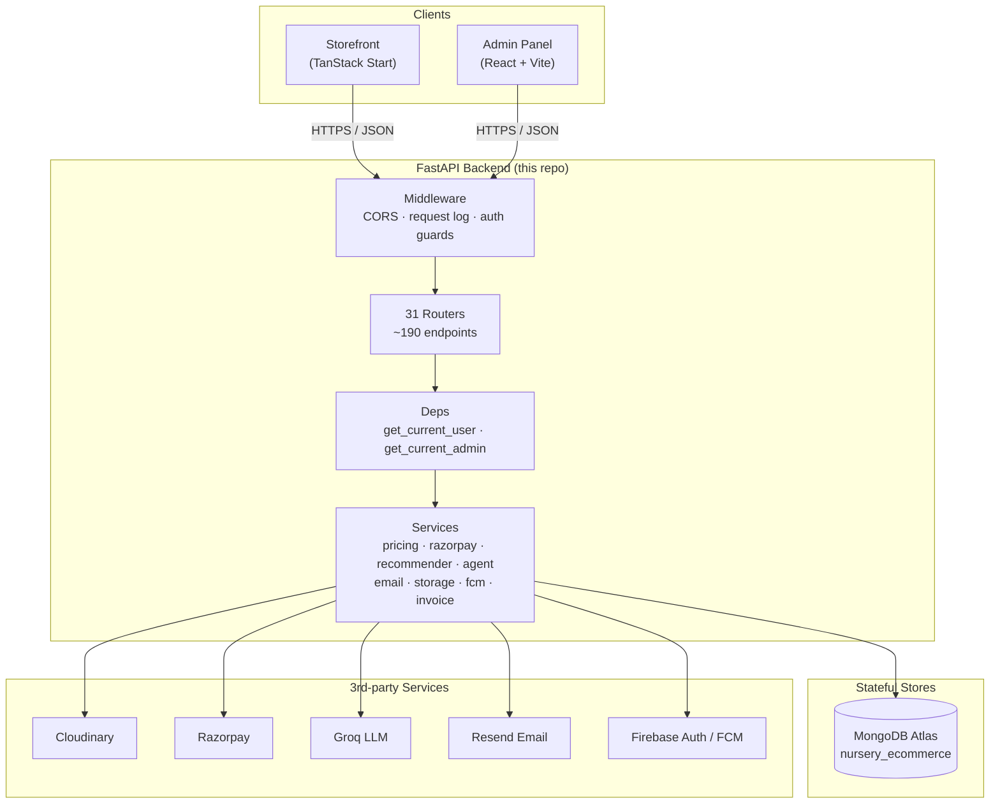
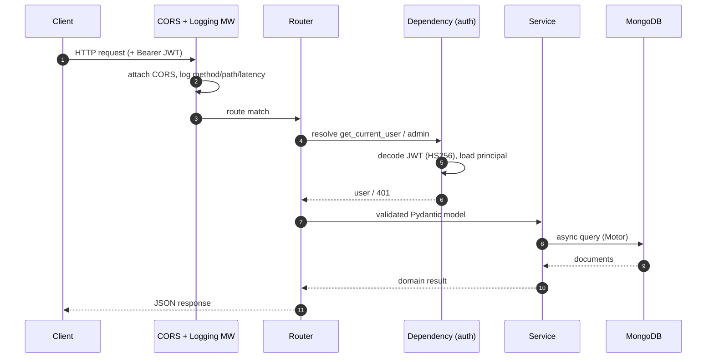
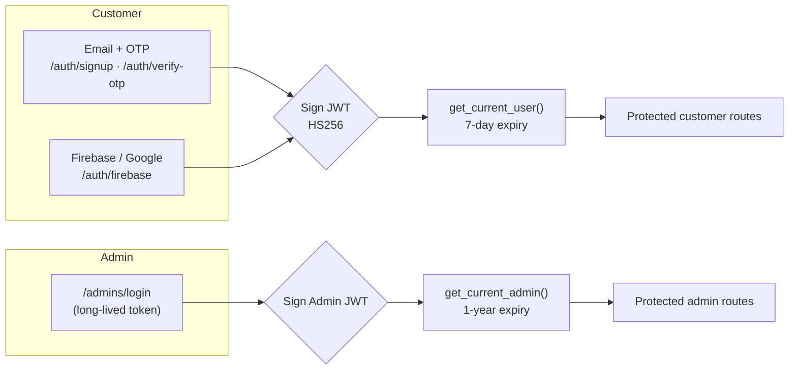
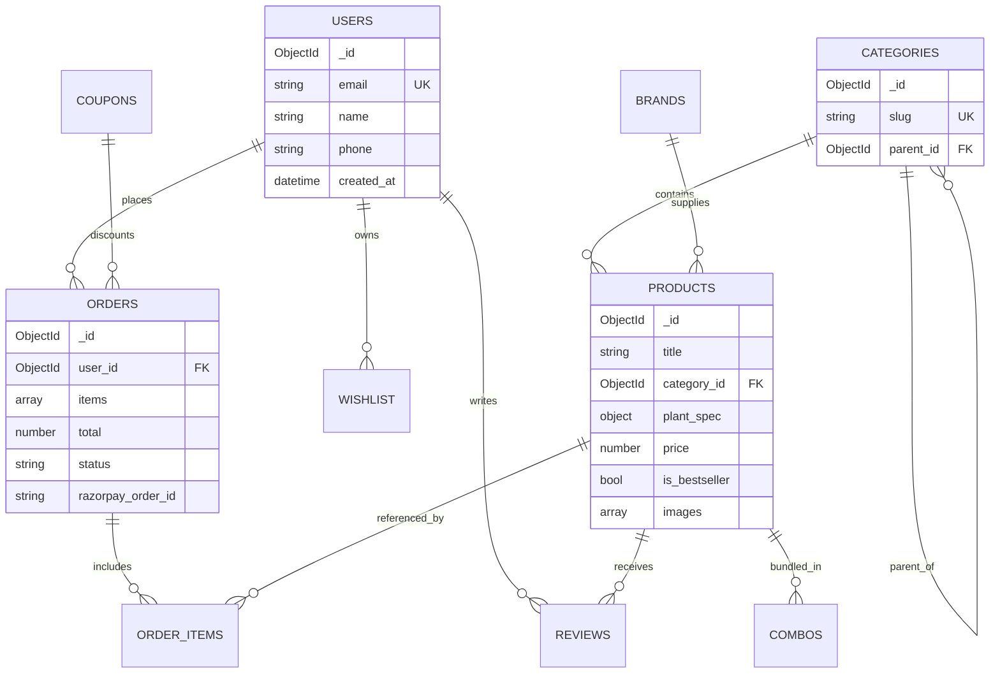
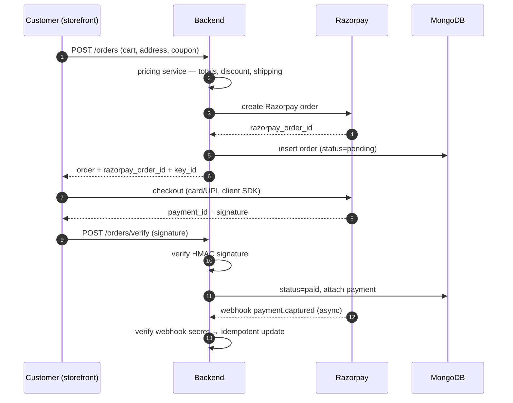

# 🐠 Jharna Aquarium — Backend API

> **Production-grade e-commerce REST API** powering the Jharna Aquarium storefront and admin panel.
> Built with **FastAPI**, **MongoDB (async / Motor)**, **Cloudinary**, **Razorpay**, **Groq AI** and **Firebase Auth**.

<p align="left">
  
  
  
  
  
  
</p>

This repository is **one of three** that make up the Jharna Aquarium platform:

| Repo | Role | Stack |
|------|------|-------|
| [`Jharna-Aquarium-Frontend`](https://github.com/ulmind-com/Jharna-Aquarium-Frontend) | Customer storefront (SSR) | TanStack Start · React · Tailwind |
| [`Jharna-Aquarium-Adminpanel`](https://github.com/ulmind-com/Jharna-Aquarium-Adminpanel) | Internal admin dashboard | React · Vite · React Router |
| **`Jharna-Aquarium-Backend`** ← _this repo_ | REST API + business logic | FastAPI · MongoDB · Motor |

> See [`docs/SYSTEM_ARCHITECTURE.md`](docs/SYSTEM_ARCHITECTURE.md) for how all three repositories communicate.

---

## 📑 Table of Contents

1. [Overview](#-overview)
2. [Tech Stack](#-tech-stack)
3. [System Architecture](#-system-architecture)
4. [Request Lifecycle](#-request-lifecycle)
5. [Authentication](#-authentication)
6. [Data Model (ER)](#-data-model-er)
7. [Order & Payment Flow](#-order--payment-flow)
8. [Project Structure](#-project-structure)
9. [API Surface](#-api-surface)
10. [Getting Started](#-getting-started)
11. [Environment Variables](#-environment-variables)
12. [Testing](#-testing)
13. [Deployment](#-deployment)
14. [Operational Scripts](#-operational-scripts)

---

## 🔭 Overview

The backend is a **modular monolith** exposing ~190 REST endpoints over **31 routers**. It owns:

- **Catalog** — products, categories, brands, combos, product lines, search (MongoDB text index).
- **Commerce** — cart-driven orders, coupons, Razorpay checkout + webhooks, returns/refunds, invoicing (PDF).
- **Identity** — email/OTP, Firebase (Google) sign-in, JWT sessions, separate admin auth with long-lived tokens.
- **Content/CMS** — home sections, page builder sections, banners, blog, press, site media, stores, garden services, gifting.
- **Engagement** — reviews, wishlist, waitlist, notifications (FCM), scheduled notifications, analytics.
- **AI** — Groq-backed product recommendations and a customer-support chat agent with tool-calling.

It is **stateless** (JWT in `Authorization` header) and talks to MongoDB Atlas, Cloudinary (media), Razorpay (payments), Groq (LLM), Resend (email) and Firebase (token verification).

---

## 🧰 Tech Stack

| Layer | Technology |
|-------|-----------|
| Language | Python 3.12+ |
| Web framework | FastAPI + Uvicorn (ASGI) |
| Database | MongoDB Atlas via **Motor** (async driver) |
| Validation | Pydantic v2 + pydantic-settings |
| Auth | PyJWT (HS256), Firebase Admin / Google Auth, bcrypt-less custom hashing in `core/security` |
| Media | Cloudinary (image + video upload, poster derivation) |
| Payments | Razorpay (orders, capture, webhook signature verification) |
| AI | Groq (OpenAI-compatible, `openai/gpt-oss-120b`) |
| Email | Resend (OTP + transactional), with dev log fallback |
| Push | Firebase Cloud Messaging |
| Documents | xhtml2pdf (invoices), openpyxl (exports) |
| Packaging | `uv` + `pyproject.toml` |

---

## 🏛 System Architecture



---

## 🔄 Request Lifecycle



---

## 🔐 Authentication

Two independent identity planes share the JWT mechanism but use different token lifetimes and guards.



- **Customer**: OTP flow (Resend email, dev logs the code) **or** Firebase ID-token verification against the public project certs (`FIREBASE_PROJECT_ID`).
- **Admin**: credential login issuing an `ADMIN_TOKEN_EXPIRE_MINUTES` token; all mutating catalog/CMS routes require it.
- Tokens are **stateless**; no server session store.

---

## 🗃 Data Model (ER)

Core collections (MongoDB is schema-flexible; shapes are enforced by Pydantic models in `app/models`).



> Indexes are created on startup in `app/db/mongodb.py` (`_ensure_indexes`): unique `users.email`, unique `categories.slug` / `brands.slug`, a product **text index** (`title`, `description`, `plant_spec.scientific_name`), plus filter indexes for faceted search and order/notification lookups.

---

## 💳 Order & Payment Flow



---

## 🗂 Project Structure

```
jharnaaquarium backend/
├── app/
│   ├── main.py              # FastAPI app, lifespan, middleware, router wiring
│   ├── deps.py              # get_current_user / get_current_admin dependencies
│   ├── core/
│   │   ├── config.py        # Pydantic settings (env-driven)
│   │   └── security.py      # JWT encode/decode, password hashing
│   ├── db/
│   │   └── mongodb.py       # Motor client, connection lifecycle, indexes
│   ├── models/              # Pydantic domain models (product, order, user, …)
│   ├── routers/             # 31 API routers (one per domain)
│   ├── services/            # pricing, razorpay, recommender, agent, email,
│   │                        # storage(cloudinary), fcm, invoice, support …
│   └── static/              # static assets (notification image)
├── scripts/                 # seeders + data migrations (see below)
├── docs/                    # engineering documentation + diagrams
├── Dockerfile
├── pyproject.toml / uv.lock
├── requirements.txt
└── .env.example
```

---

## 🌐 API Surface

Base URL (prod): configured per deployment. Interactive docs at **`/docs`** (Swagger) and **`/redoc`**.

| Prefix | Router | Routes | Prefix | Router | Routes |
|--------|--------|:--:|--------|--------|:--:|
| `/auth` | auth | 10 | `/orders` | orders | 16 |
| `/admins` | admins | 5 | `/garden-services` | garden_services | 15 |
| `/products` | products | 7 | `/reviews` | reviews | 12 |
| `/categories` | categories | 5 | `/chat` | chat (AI agent) | 8 |
| `/brands` | brands | 2 | `/page-sections` | page_sections | 8 |
| `/combos` | combos | 5 | `/home-sections` | home_sections | 6 |
| `/product-lines` | product_lines | 2 | `/blog` | blog | 7 |
| `/coupons` | coupons | 7 | `/press` | press | 7 |
| `/recommendations` | recommendations (AI) | 3 | `/site-media` | site_media | 7 |
| `/wishlist` | wishlist | 4 | `/stores` | stores | 7 |
| `/waitlist` | waitlist | 3 | `/users` | users | 7 |
| `/search` | search | 3 | `/upload` | upload (Cloudinary) | 4 |
| `/banners` | banners | 4 | `/settings` | settings | 4 |
| `/analytics` | analytics | 1 | `/countries` | countries | 2 |
| `/gifting` | gifting | 2 | `/certifications` | certifications | 2 |
| `/google-reviews` | google_reviews | 3 | | | |

Health check: `GET /` → `{"status":"ok","app":...,"env":...}`.

---

## 🚀 Getting Started

### Prerequisites
- Python **3.12+**
- [`uv`](https://docs.astral.sh/uv/) (recommended) — or `pip` + `requirements.txt`
- A MongoDB connection string (Atlas or local)

### Install & run (uv)

```bash
cp .env.example .env     # then fill in secrets
uv sync                  # install deps from uv.lock
uv run uvicorn app.main:app --reload --port 8000
```

### Install & run (pip)

```bash
python -m venv .venv && source .venv/bin/activate
pip install -r requirements.txt
cp .env.example .env
uvicorn app.main:app --reload --port 8000
```

Open <http://localhost:8000/docs>.

---

## 🔑 Environment Variables

All configuration is read from `.env` via `app/core/config.py`. **Never commit `.env`** — it is git-ignored. See [`.env.example`](.env.example) for the full template.

| Variable | Purpose |
|----------|---------|
| `MONGO_URI`, `MONGO_DB` | MongoDB Atlas connection + database name |
| `JWT_SECRET`, `JWT_ALGORITHM` | Token signing |
| `ACCESS_TOKEN_EXPIRE_MINUTES`, `ADMIN_TOKEN_EXPIRE_MINUTES` | Session lifetimes |
| `CORS_ORIGINS` | Comma-separated allowed origins |
| `RAZORPAY_KEY_ID` / `_SECRET` / `_WEBHOOK_SECRET` | Payments |
| `CLOUDINARY_CLOUD_NAME` / `_API_KEY` / `_API_SECRET` | Media uploads |
| `GROQ_API_KEY`, `GROQ_AGENT_API_KEY`, `GROQ_MODEL` | AI recommendations + chat |
| `FIREBASE_CREDENTIALS`, `FIREBASE_PROJECT_ID` | Token verification / FCM |
| `RESEND_API_KEY`, `MAIL_ADDRESS`, `MAIL_FROM_NAME` | Transactional email |
| `PUBLIC_BASE_URL`, `CRON_SECRET` | Absolute URLs + cron auth |

---

## 🧪 Testing

Smoke/integration scripts live at the repo root and exercise the live API + MongoDB:

```bash
uv run python test_mongo.py           # verify DB connectivity
uv run python test_api.py             # basic endpoint smoke test
uv run python test_post_products.py   # product create path
```

CI runs an import/boot check (see `.github/workflows/ci.yml`). Add `pytest`-based tests under `tests/` — `pytest` and `httpx` are already dev dependencies.

---

## 📦 Deployment

A `Dockerfile` is included:

```bash
docker build -t jharna-backend .
docker run -p 8000:8000 --env-file .env jharna-backend
```

The app is deployment-ready for Render / Railway / Fly / any ASGI host:

```bash
uvicorn app.main:app --host 0.0.0.0 --port $PORT
```

Set all secrets as environment variables in the platform dashboard (do **not** ship `.env`).

---

## 🛠 Operational Scripts

`scripts/` contains idempotent seeders and migrations used during development:

- `seed.py`, `seed_nursery.py`, `seed_blog.py`, `seed_demo.py`, … — populate catalog/content.
- `migrate_v2.py`, `migrate_brands.py` — one-off data migrations.
- `fetch_seed_photos.py`, `set_demo_images.py` — media backfill.

Run with `uv run python scripts/<name>.py`. Review each before running against a shared database.

---

<sub>Part of the **Jharna Aquarium** platform · Backend service · FastAPI + MongoDB</sub>
